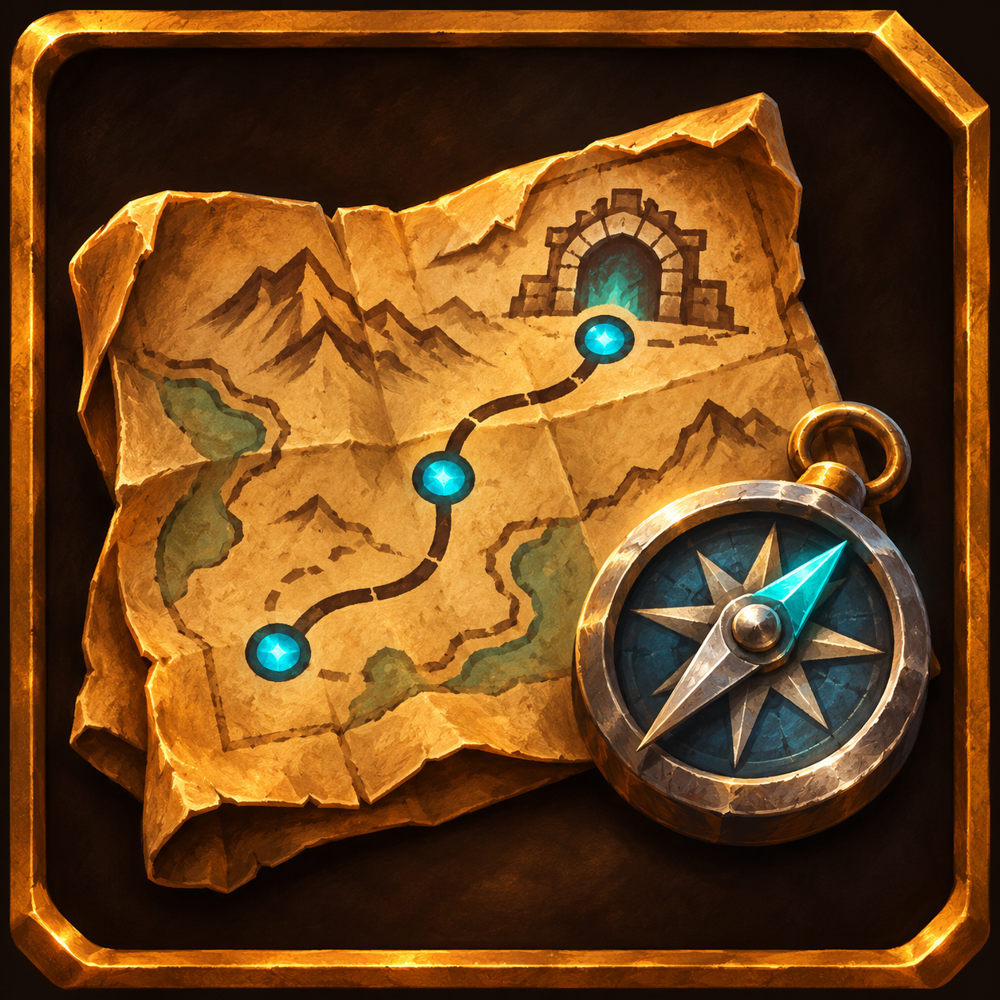
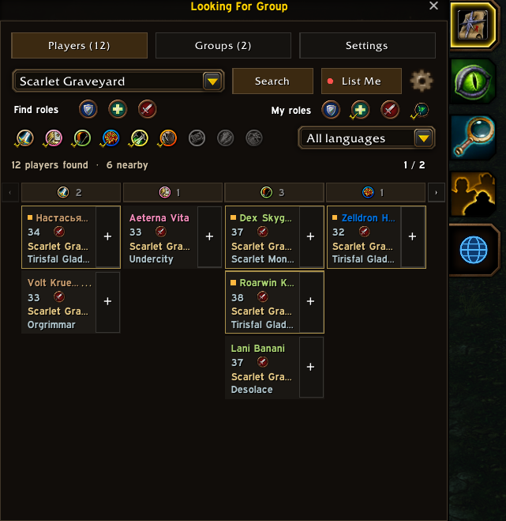
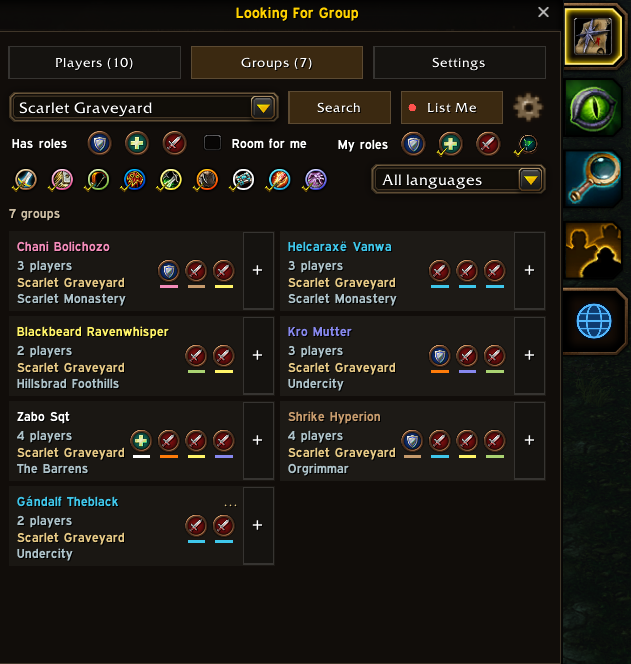
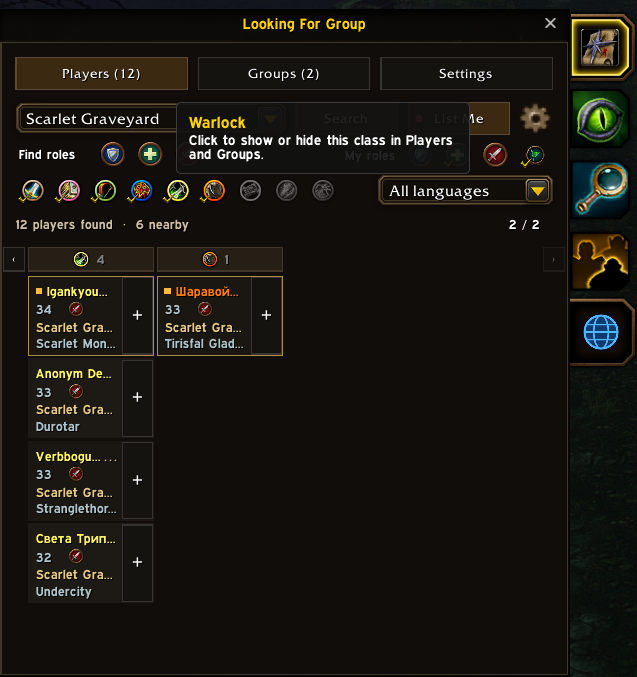
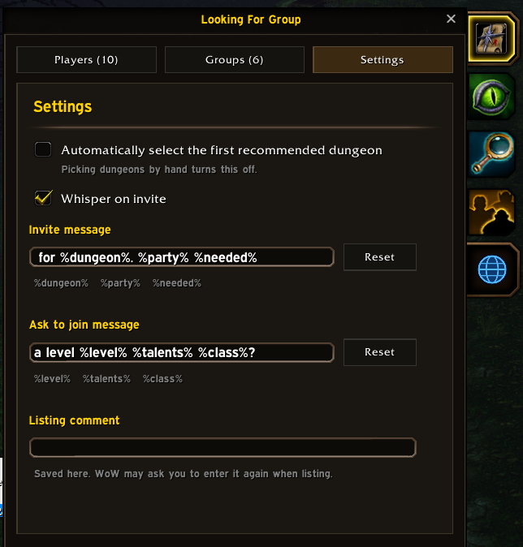

  

<h1 align="center">LFG Party Finder</h1>

  Dungeon LFG for the World of Warcraft: Forever Group Finder.

  <a href="https://github.com/Antrakt92/LFGPartyFinder/releases/latest"><strong>Download for Forever</strong></a>
  · <a href="CHANGELOG.md"><strong>Changelog</strong></a>

  
  

Find dungeon players and groups from the regular Group Finder window. See who is
near the dungeons you chose, compare group composition, and create your own
listing from the same panel.

  <a href="#installation">Install</a>
  · <a href="#getting-started">Quick setup</a>
  · <a href="#features">Features</a>
  · <a href="#help-and-feedback">Help</a>

| Players | Groups | Your listing |
|---|---|---|
| Class columns, role filters and nearby players first. | Group roles, class colors, and a filter for an open slot that matches your roles. | Pick your roles, list yourself or your party, and unlist with one click. |

Group search, class filters, and settings

## Installation

Download the packaged ZIP under **Assets** in the
[latest release](https://github.com/Antrakt92/LFGPartyFinder/releases/latest).
Extract the `PartyFinderForever` folder into `Interface/AddOns` in your WoW Forever
client. The addon is standalone and is built for WoW Forever 1.60.1.

## Getting started

1. Press **I**, the default Group Finder binding, or type `/pff`. The map button
   beside Group Finder opens the same panel.
2. Select one or more dungeons and click **Search**. The first recommended dungeon
   is selected automatically until you choose dungeons by hand or turn that setting off.
3. Switch between **Players** and **Groups**. Click a class icon to include or
   exclude it in both views, or use **All languages** to narrow the search languages.
4. Click **+** to invite a player or contact a group leader. Right-click a card for
   **Send Message** and other actions.

## Features

- **Players.** Browse by class and role. Players in or near the selected dungeon
  appear first in each class column. Hover for the full name, location, activities,
  and specialization when the game supplies it.
- **Groups.** See roles and class colors. Filter for a group that already has a tank,
  healer or damage dealer, or use **Room for me** to match an open slot to your roles.
  Hover to see the roster and any listing comment.
- **Listing.** Choose one or more roles and use **List Me** or **List Party**. The flag
  marks a listing as **New Player Friendly**. Listing options include playstyle and
  voice chat. To publish with a comment, type in the WoW field in Settings and use
  the listing button below it.
- **Messages.** Customize invite and join whispers in Settings. With an empty
  join-message template, the addon uses WoW's request-invite action.
- **Search languages.** All supported languages are enabled by default. The search
  uses the listings available in your WoW session.

## Help and feedback

- `/pff` opens LFG Party Finder.
- `/pff settings` opens Settings.
- Report a problem in [GitHub Issues](https://github.com/Antrakt92/LFGPartyFinder/issues).
- See [LICENSE](LICENSE) for reuse terms.
